# Scopewright user guide

Scopewright turns a conversation with a customer into a signed-off
proof-of-concept scope with the hours it will take. This guide walks through the whole workflow using the
fictitious **Solstice Systems** example that ships in `packs/solstice`.

Contents

1. [The workspace](#the-workspace)
2. [Building an estimate](#building-an-estimate)
3. [The scope document](#the-scope-document)
4. [Weekly updates](#weekly-updates)
5. [Saving, exporting, and importing estimates](#saving-exporting-and-importing-estimates)
6. [Saved estimates](#saved-estimates)
7. [Managing the estimate catalog](#managing-the-estimate-catalog)
8. [Branding and themes](#branding-and-themes)
9. [Loading the Solstice example](#loading-the-solstice-example)
10. [Editors and viewers](#editors-and-viewers)

## The workspace

The sidebar has two sections. **Workspace** is day-to-day use: New estimate,
Scope documents, Weekly updates, and Saved estimates. **Manage** is setup: the Estimate catalog
(what your team delivers and the hours each piece takes) and Settings (how the workspace
looks). The bottom of the sidebar shows who is signed in and the sync state
of the shared catalog and brand, for example "Shared workspace · synced" or
"View only". After Scopewright is updated, a tab that was left open shows
**Reload to keep working** and "Not saving · reload the page" the next time
it tries to save a catalog change: the server only accepts changes from the
current version, so an old page cannot overwrite what it does not understand.
Reload the page and make the change again; your estimate draft is kept.

Two kinds of data live in Scopewright:

- **Shared**: the catalog and the brand. Everyone who opens the workspace
  sees the same ones; only editors can change them.
- **Yours**: your estimates. The one you are building is a draft in your
  browser, and you save it as a file wherever you choose: this browser, a
  folder on your computer, or Google Drive if your deployment offers it.
  Estimates are never stored on the Scopewright server, so customer names
  stay out of the shared workspace.

## Building an estimate

Open **New estimate**. The six steps run left to right, and the **Live
estimate** card on the right updates with every choice: total hours, the
equivalent working days, a planning range of ±20 percent, and a line per
product and deliverable group.

### 1. Engagement

<!-- screenshot needed: img/000-estimate-engagement.png (the Engagement step, with an out-of-scope item ticked) -->

Who the engagement is for and what it must prove: customer name, engagement
title, the POC goal, **success criteria** and **assumptions** (one per
line), and what is **out of scope**. Out-of-scope items come from two places:
checkboxes for the common exclusions your editors keep in the catalog, and a
free-text box for anything specific to this customer. Everything here prints
in the scope document.

### 2. Products

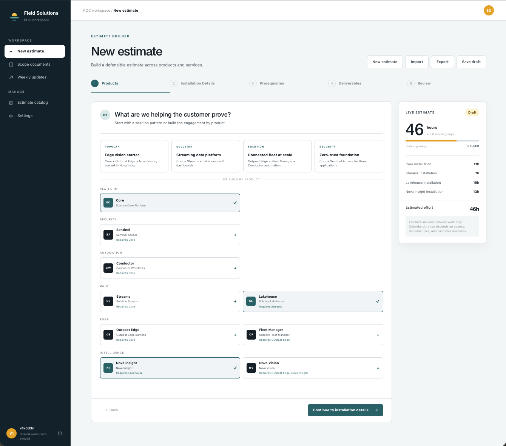

Start with a **solution card** at the top, which selects a pre-canned set of
products in one click, or build by product from the portfolios below. A
product that **requires** a foundation (Lakehouse requires Streams, which
requires Core) pulls the foundation into the estimate automatically; the
Products step shows the requirement under each product. The solution cards
come from the catalog and can be empty.

### 3. Installation details

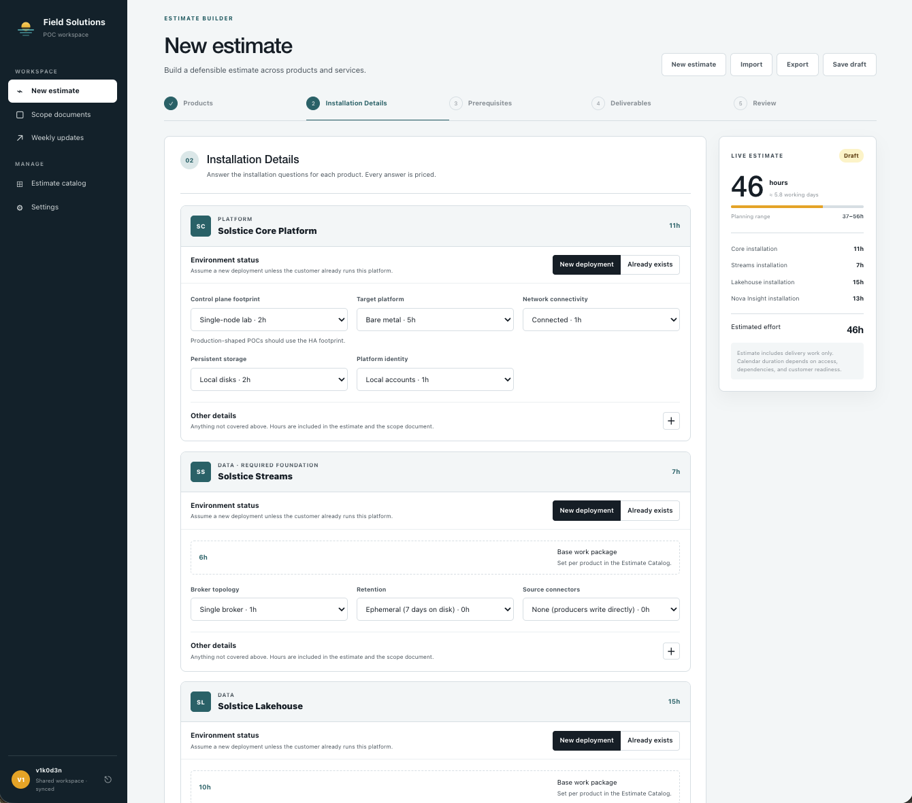

Every product in the engagement gets a frame with its **installation
decisions** as drop-downs, each answer carrying hours. Products the customer
already runs can be switched to **Already exists**, which removes their
installation hours but keeps their prerequisites and deliverables available.
A product's **base work package** (if it has one) is shown for transparency.
**Other details** lets you add free-text work with hours for anything the
catalog does not cover; it appears in the estimate and the scope document.

A question you have not answered uses its first choice. If the answer saved
with an estimate has since been removed from the catalog, the question is
left **unanswered** rather than switched to another answer: its drop-down
reads *Choose an answer…* with a note, the frame header counts what is left
to answer, no hours are counted for it, and the scope document prints
*To be decided* until you choose.

### 4. Prerequisites

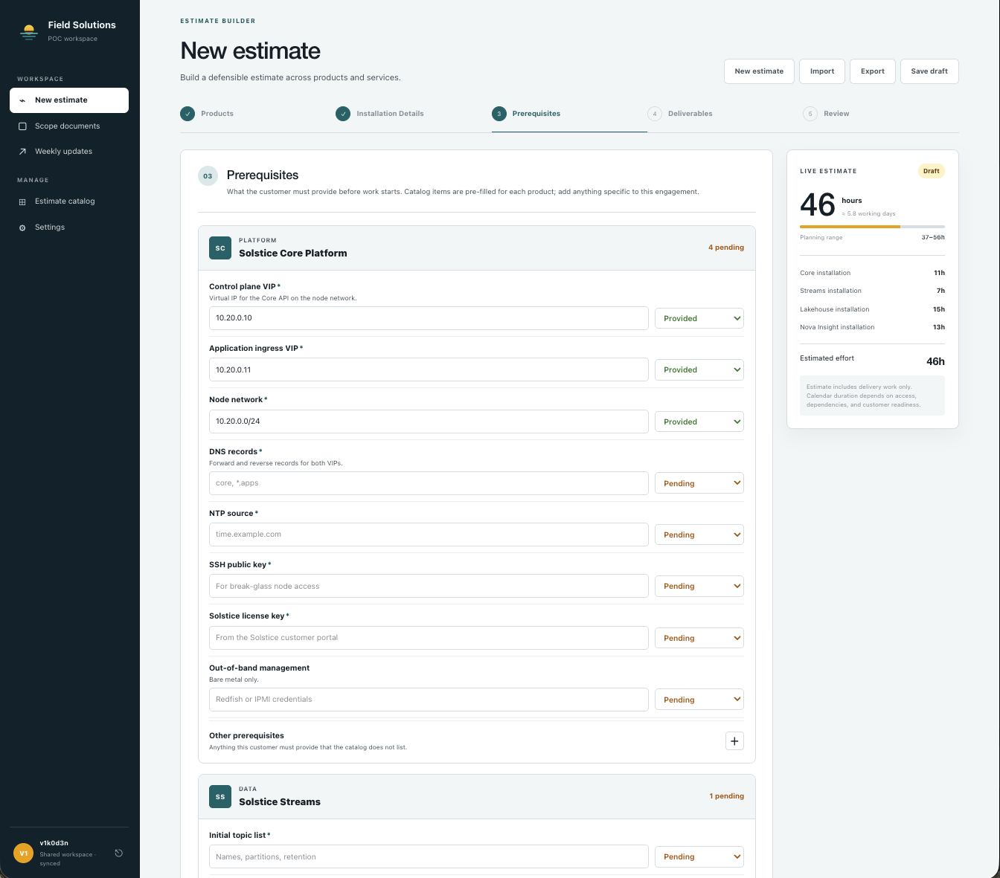

What the customer must provide before work starts, pre-populated from the
catalog for each product: VIPs, networks, DNS, credentials, licenses, sample
data, and so on. Type the value and the status flips to **Provided**; set
**Pending** or **Not applicable** by hand. Required items are starred and the
frame header counts what is still pending. **Other prerequisites** adds items
specific to this engagement.

### 5. Deliverables

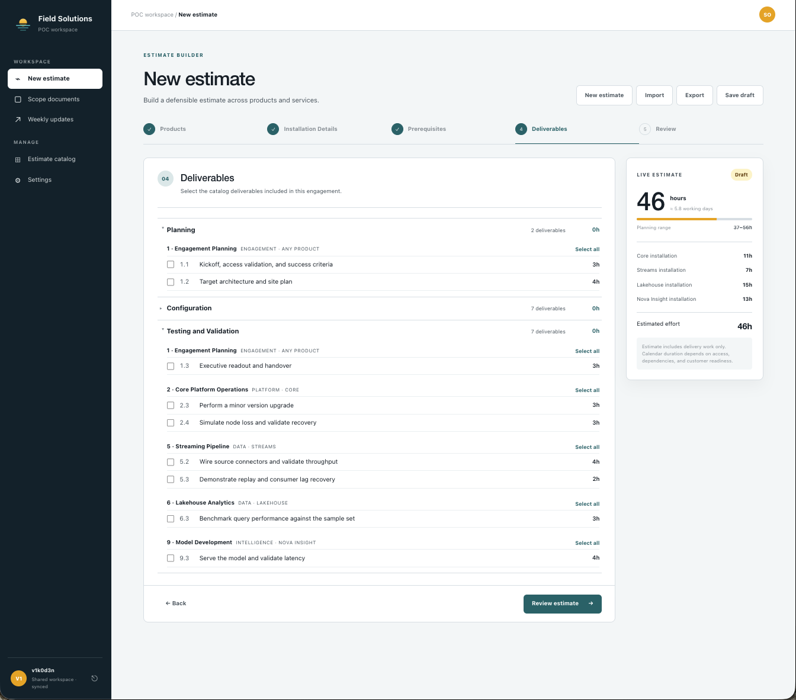

Deliverables are grouped by delivery phase (Planning, Prerequisites,
Deployment, Configuration, Testing and Validation) and within a phase by
catalog group. Only groups tied to a product in the engagement, or to no
product, are offered. **Select all** and **Clear all** at the top act on
everything offered; each phase has its own **Select phase** control and each
group its own **Select all**. Deselect what the engagement does not need; the
phase header totals the hours selected.

A task that was selected before it was turned off in the catalog stays in the
estimate, marked **No longer offered**, with its hours. Clear it if the
engagement no longer needs it; once cleared, it is not offered again.

### 6. Review

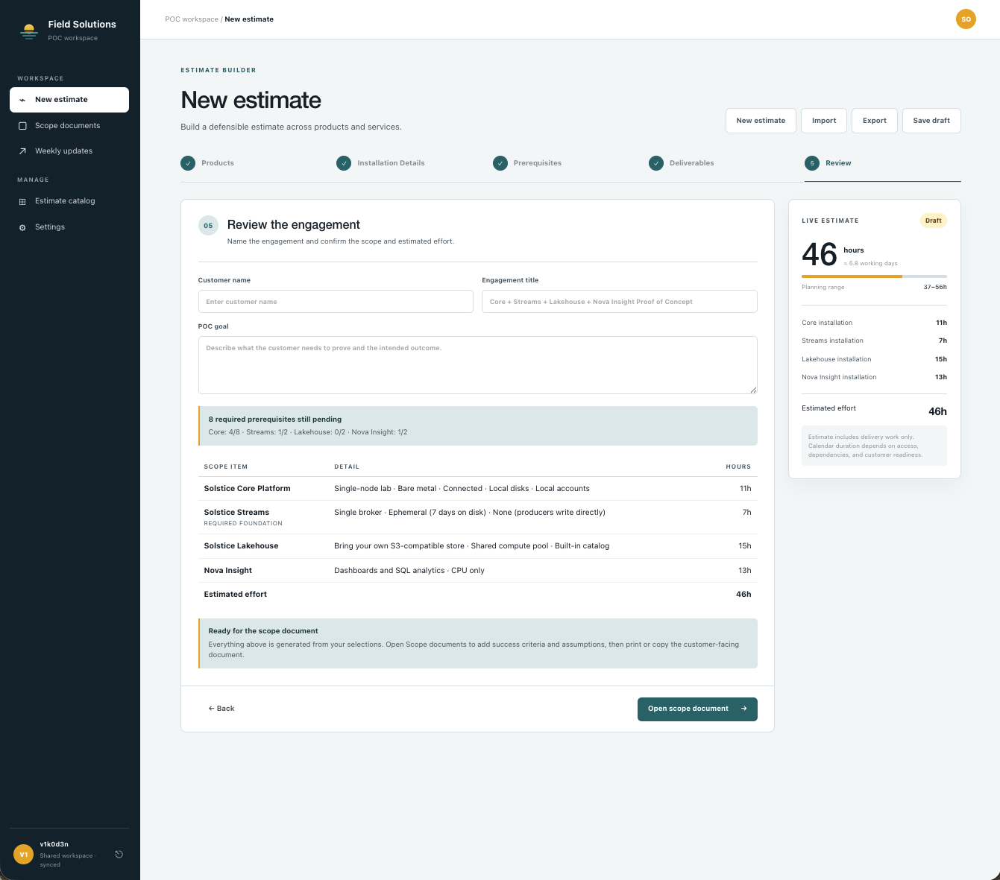

A summary of the engagement details (including the document's custom
sections) with a link back to step 1, and the
scope table: one row per product with its chosen decisions and hours, one per
deliverable group, and the total. A banner shows how many required
prerequisites are still pending, and another lists any installation questions
whose saved answer the catalog no longer offers, with a link back to
Installation details. **Open scope document** saves the draft and moves on.

## The scope document

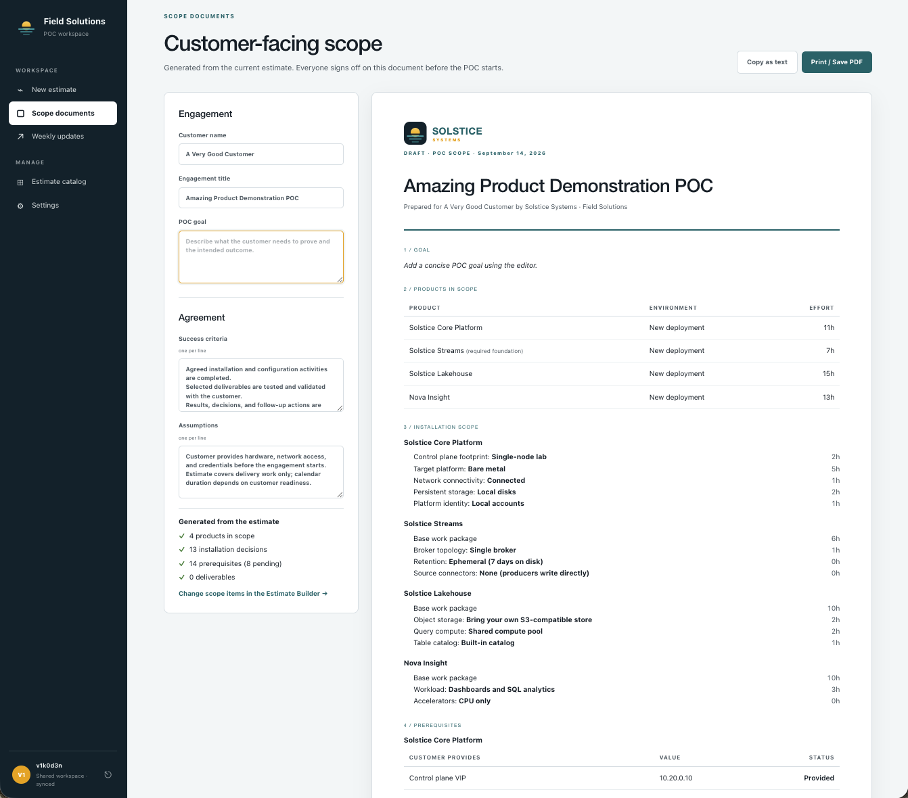

The scope document is generated from the estimate and is the paperwork the
customer, the account team, and the delivery team sign off on. This page is
the final review: the narrative is written in the Engagement step, and the
panel on the left holds presentation **options**. **Show hours** can be
turned off to discuss scope and prerequisites without effort; it removes
every hour figure and the effort summary from the preview, the PDF, and the
copied text, and is saved with the estimate. The document has up to nine
sections, numbered as they appear: goal, products in scope, installation
scope, prerequisites with values and status, delivery plan with numbered
deliverables, out of scope, effort summary with the planning range, success
criteria, and assumptions, followed by sign-off lines and the footer from
Settings. Custom sections, described below, add your own.

**Sections** in the same panel lists the numbered sections in the order they
print. **↑** and **↓** move a section, and turning off **Print** leaves it out
of the preview, the PDF, and the copied text. Sections are renumbered as they
move. A section with nothing to print, such as the effort summary while hours
are hidden, stays in the list with the reason beside it. The order is saved
with the estimate; **Restore the default order** puts every section back and
prints them all.

**+ Add section** writes a section of your own, such as contacts, a schedule,
or who is responsible for what, either blank or from one of your team's
[section templates](#section-templates), listed by category. It gets a title
and any mix of text and tables, and moves and prints like any other section.
A template is copied into the estimate: when the catalog's version changes,
the section's editor offers the new one, and a locked template's copy cannot
be edited. In text, a blank line starts a new paragraph, `{customer}`,
`{title}`, `{products}`, and `{organization}` are filled in from the estimate
(anything else in braces prints as typed, and the editor points it out),
lines starting
with `- ` print as bullets, and lines starting with `1. ` print as a numbered
list that starts at the number you type. Indent a line by two spaces to put
it in a list under the line above. A table has up to eight columns; the first row of
the editor is the heading. Select a custom section's name in the list to edit
or delete it. Custom sections belong to the estimate, so they are saved,
exported, and copied as text with it.

**Print / Save PDF** uses a print stylesheet that drops the app chrome and
keeps the logo. **Copy as text** puts a plain-text version on the clipboard
for email or a ticket.

## Weekly updates

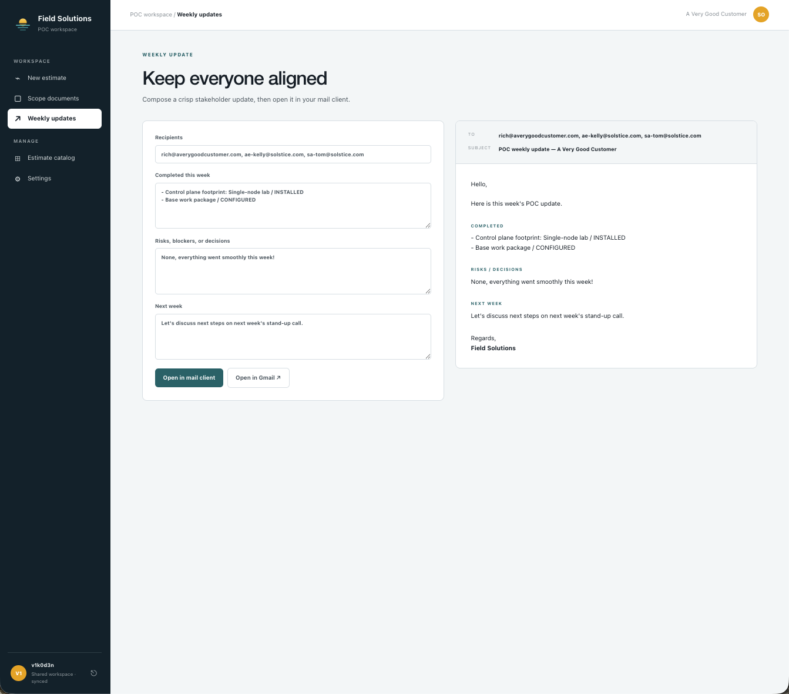

A small composer for the weekly stakeholder note: recipients, what was
completed, risks or decisions, and next week. The preview on the right shows
the email as it will be sent, signed with the workspace name. **Open in mail
client** or **Open in Gmail** hands the draft to your mail app; Scopewright
never sends mail itself.

## Saving, exporting, and importing estimates

<!-- screenshot needed: img/008-estimate-menu.png (the Estimate menu open, showing the Saved/Unsaved status and the "Saved as ..." line under the title) -->

Everything that happens to the estimate as a file is in one place: the
**Estimate** menu at the top of the New estimate page. Beside it you can see
whether the estimate is saved or has unsaved changes, and the line under the
title names the file it is saved as.

- **New estimate** starts from blank, after confirming if there are unsaved
  changes. A file you had open is closed and unlocked.
- **Import…** loads an exported file after showing what it contains. Hours are
  recomputed against the current catalog, so the numbers reflect today's
  catalog. Products that no longer exist in the catalog are dropped with a
  warning (see [When the catalog has changed](#when-the-catalog-has-changed)).
- **Export** downloads the estimate as a versioned JSON file named after the
  customer and date: a copy to attach to the deal or hand to someone.
- **Save** writes the estimate back to the file it came from. For an estimate
  that has never been saved, it opens Save as.
- **Save as…** asks where (one of your save locations) and under what file
  name. Saving under a name that already exists replaces that file, after
  asking, the way saving works anywhere else; it does not pile up copies. A
  file that someone else has open cannot be replaced.

<!-- screenshot needed: img/009-save-as.png (the Save as dialog) -->

Your work in progress is also kept as a draft in this browser as you type, so
a refresh does not lose it.

### When the catalog has changed

An estimate refers to catalog items by id, and its hours, names, and wording
are read from the current catalog every time it is opened or imported. When
the catalog has changed in a way that affects the estimate, a **This estimate
needs attention** dialog lists what changed, section by section:

- **Installation details · choose a new answer**: questions whose saved
  answer the catalog no longer offers. Until you choose, the question is
  unanswered, no hours are counted for it, and the scope document prints
  *To be decided*.
- **Products · no longer in the catalog, left out**: products that were
  removed from the catalog; they are dropped from the estimate.
- **Deliverables · no longer offered, kept**: selected tasks that were turned
  off in the catalog. They stay in the estimate with their hours; nothing
  needs doing unless you want to remove them.

**Review installation details** (or **Review products**) takes you to the
step to fix; **Not now** closes the dialog, and the warnings stay: unanswered
questions in Installation details and on the Review page, and products that
were left out on the Review page until you save (including after a page
refresh). Nothing is written to the
file until you save.
If the only change is a kept deliverable, a short notice says so instead.

The scope document always reflects the current catalog: an option that was
renamed prints its new name, and changed hours print the new hours. The
original wording of a removed option is not kept in the estimate, so the PDF
printed at the time remains the record of what was agreed. Custom sections
are the exception: they are copied into the estimate and print the same
whatever happens to the template they came from.

An estimate from before custom sections that has an introduction or closing
opens with them as custom sections named "Introduction", printed first, and
"Closing", printed last, with the same wording.

### Estimates from a newer Scopewright

An estimate saved by a newer release of Scopewright (for example, by a
colleague on a workspace that has already been updated) may contain details
this release does not understand. Saving it here would lose them, so it opens
**view only**: a banner explains why, every step and the scope document can
be read and printed, and Save, Save as, and Export are unavailable. The file
is not locked while you view it. In Saved estimates such a file is tagged
**Newer version · view only**. Open it in an up-to-date Scopewright to change
it. [formats.md](formats.md) explains how file versions work.

## Saved estimates

<!-- screenshot needed: img/030-saved-estimates.png (source cards, a list with one estimate "Open here" and one "Locked by ...") -->

**Saved estimates** in the sidebar is where you set up save locations, see
what is saved in each, and open an estimate back into the builder. It is how
you keep more than one estimate going at once. Saving itself happens in the
builder's Estimate menu. The locations:

- **This browser** keeps them in this browser only. Nothing to set up, private
  to you, and gone if you clear site data.
- **Local folder** keeps each estimate as a JSON file in a folder you choose.
  Choose a synced or network folder and a team can share it. It needs Chrome
  or Edge; other browsers cannot open folders, and Import and Export remain
  the way to move files there. The browser asks for permission to the folder,
  and may ask again after a restart.
- **Google Drive**, when your deployment has set it up, keeps each estimate as
  a JSON file in a Drive folder you choose. You sign in to Google in Google's
  own window; Scopewright never sees your password. It asks only for access to
  files it creates or you pick, not the rest of your Drive. Share the folder
  in Drive to work with a team. The session lasts about an hour; reconnecting
  is one click while you are signed in to Google. **Delete** moves a file to
  the Drive trash.

**Change folder** picks a different folder. For a local folder, create new
folders in the dialog your computer shows. Google's folder chooser cannot
create folders, so Google Drive also has **New folder…**, which creates one
inside the current folder and switches to it. Either way an open estimate is
closed first, since it belongs to the folder you are leaving.

**Open** loads an estimate into the builder and marks it "Open here". From
then on **Save** writes back to that file. If the catalog has changed since
the estimate was saved, you are told what needs attention (see
[When the catalog has changed](#when-the-catalog-has-changed)).

Files go straight from your browser to the place you chose. They are never
sent to or stored on the Scopewright server, so customer names stay out of
the shared workspace.

Each browser tab has its own open estimate, so you can work on two at once
in two tabs. The estimate that is open in a tab cannot be deleted from the
list; start a new estimate or open another one first.

Which locations appear is up to whoever runs your Scopewright. Setting up
Google Drive for a deployment is covered in [Estimate sources](sources.md).

### Locking

An estimate that someone has open is locked: others see who has it and cannot
open or delete it. The lock is released when they start a new estimate, open
another one, or disconnect. If a browser is simply closed, the lock expires by
itself after ten minutes.

Importing a file, like starting a new estimate, closes and unlocks the
estimate you had open.

The lock is a courtesy, not a guarantee. As a backstop, saving checks that the
file has not changed since you opened it. If it has, nothing is overwritten
and you are told; use **Save as…** to keep your version under another name.

None of these places can check and write in one step, so two saves landing in
the same instant is the one case that can slip through. The check is made as
late as each place allows to make that unlikely, and on Google Drive, if it
does happen, you are told and the other version is still in the file's
version history.

## Managing the estimate catalog

Building a catalog from scratch, by hand or with an AI assistant? Read
[authoring.md](authoring.md) first: it explains the model, the file format,
and the conventions, and includes a prompt to hand to an AI tool.

The catalog is the shared source of everything an estimate can contain. It
has six tabs, and each tab drives one part of the estimate workflow.

### Products

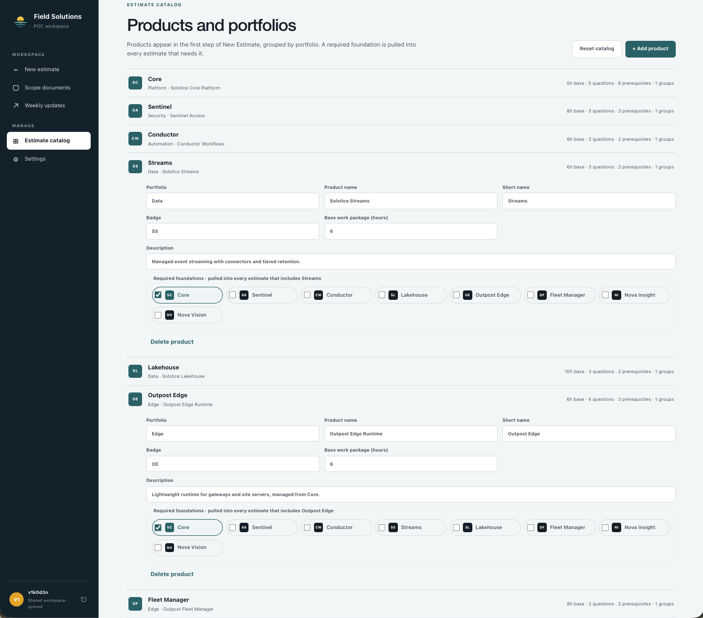

Each product has a portfolio (the heading it appears under), a full name and
short name, a two- or three-letter badge, an optional **base work package**
in hours, a description, and **required foundations**: other products that
are pulled into any estimate that includes this one. A product may require
several. Deleting a product also removes its questions, prerequisites,
deliverable groups, and its mention in solutions.

### Solutions

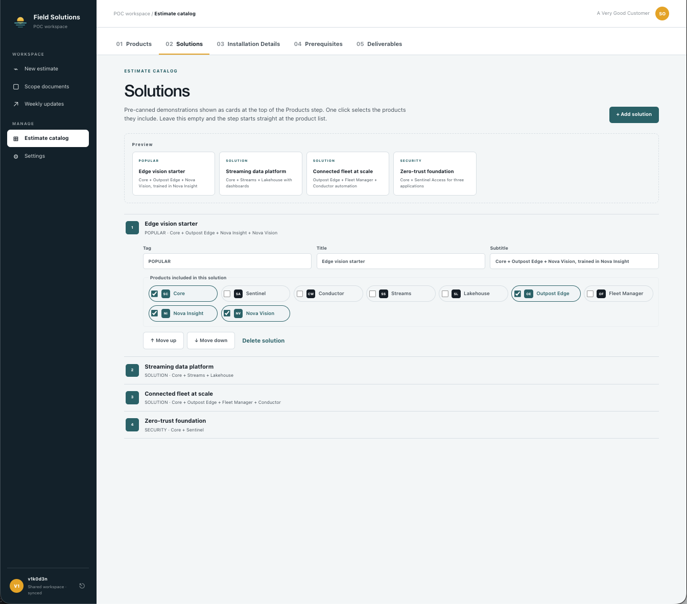

Solutions are the cards at the top of the Products step: a tag ("POPULAR",
"SOLUTION", or anything you like), a title, a subtitle, and the products
they select. The preview shows exactly what the Products step will render.
Reorder with the arrows; leave the list empty and the Products step starts
straight at the product list.

### Installation details

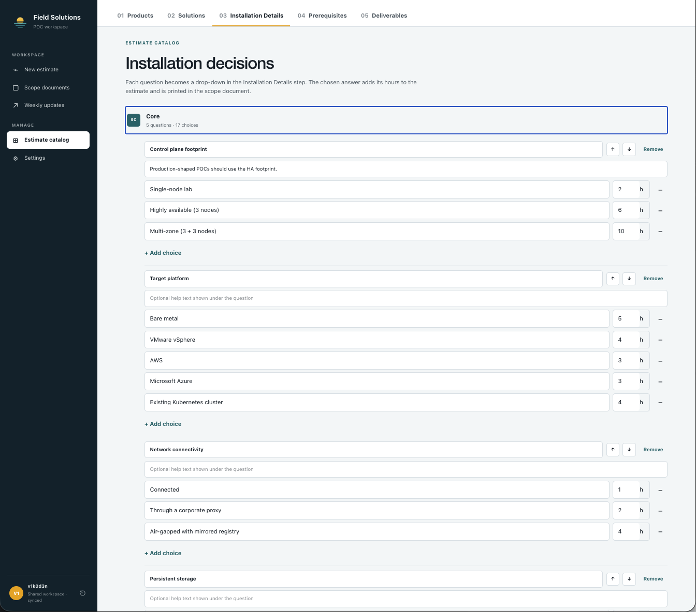

Each product's decision tree. A **question** has optional help text and a
list of **choices**, each with hours. Questions become drop-downs in the
Installation details step; the chosen answer adds its hours and is printed in
the scope document. Reorder questions with the arrows. Removing a choice that
saved estimates use leaves that question unanswered in those estimates, for
the architect to answer again; it is never replaced by another choice.

### Prerequisites

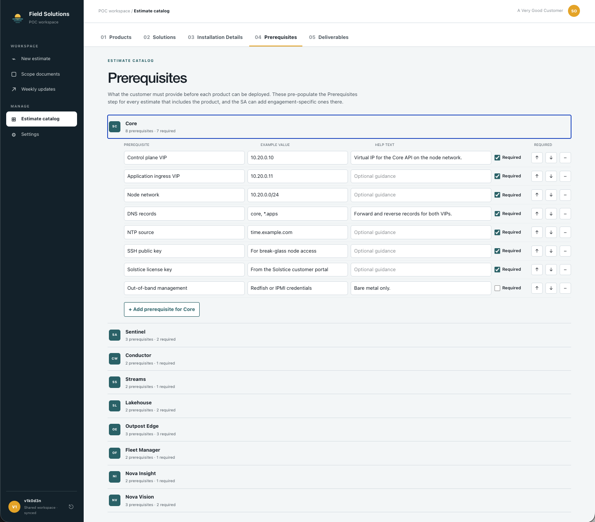

Each product's list of what the customer must provide: a label, an example
value shown as the placeholder, optional help text, and whether it is
required. These pre-populate the Prerequisites step; the SA can still add
engagement-specific ones there.

### Deliverables

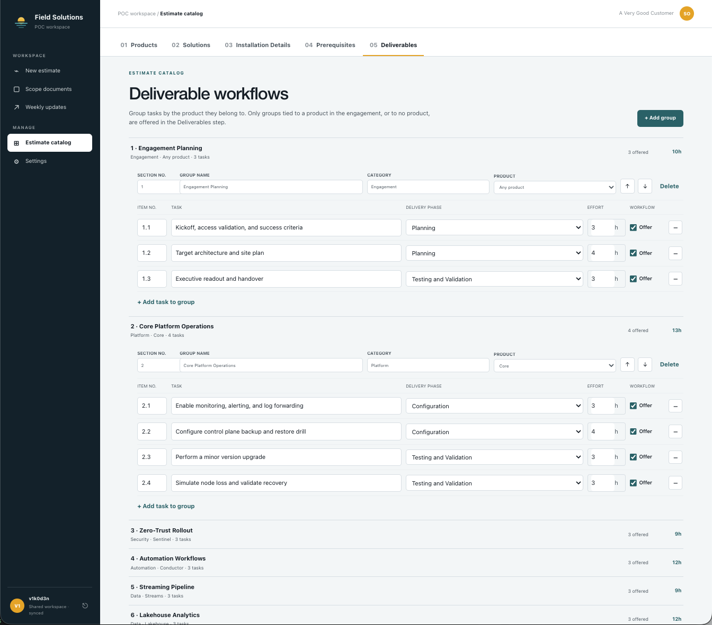

Deliverable **groups** have a section number, a name, a category, and the
product they belong to ("Any product" for engagement-wide work such as
kickoff and readout). Each **task** has an item number, a delivery phase,
hours, and an **Offer** toggle that controls whether it is offered in the
Deliverables step. Turning a task off only stops it being offered: estimates
that already selected it keep it, marked **No longer offered**. **Offer all** and **Offer none** at the top switch every
task at once, and the same button on each group does it for that group alone. Numbering carries through to the scope document.

### Out of scope

<!-- screenshot needed: img/015-catalog-out-of-scope.png -->

A simple list of things your team commonly excludes from an engagement. They
appear as checkboxes in the Engagement step.

### Section templates

Custom sections your teams use again and again: contacts, a responsibility
matrix, an engagement schedule, or anything else made of text and tables.
Each has a title, a **category** that groups it in the Add section list (for
example the kind of engagement, or the team that uses it), and an optional
note on when to use it. **Offer in workflow** controls whether it is listed
when an architect adds a section; one that is not offered stays in the
catalog. **Lock wording** is for wording that must be used exactly as
written, for example a statement your organization has approved: an estimate
that adds a locked template cannot edit its copy. Without it, a template is a
starting point that architects adapt. Adding a template copies it, so
editing, turning off, or deleting it never changes an estimate that already
uses it; an unedited copy is offered the new version, and an edited one is
offered it only once the template is locked. A catalog from before section
templates that has introduction and closing templates imports them as
section templates, grouped under each template's name. The Solstice pack
includes five to start from.

### Deleting catalog items

Every tab deletes the same way. Tick the checkbox beside each product,
solution, question, prerequisite, deliverable group, or out-of-scope item you
want gone (or tick **Select all** in the bar above the list), then choose
**Delete selected**. A confirmation lists what will be deleted, and what goes
with it: deleting a product also deletes its installation questions,
prerequisites, and deliverable groups, and removes it from foundations and
solutions. The catalog is shared, so the change applies to everyone.

The small **×** beside an installation choice or a deliverable task removes
just that line from the question or group you are editing. The **↑** and **↓**
buttons set the order where the order shows up in an estimate or the scope
document. Products are always listed alphabetically, here and in the Products
step of New Estimate (where portfolios are alphabetical too).

**+ Add product** opens a new product at the top of the list. It stays out of
the catalog until you choose **Save product**, so nobody else sees a
half-finished entry; **Cancel** discards it.

Catalog export, import, and **Delete catalog** (which empties the whole
catalog, after you type `DELETE` to confirm) live in Settings (see below).

## Branding and themes

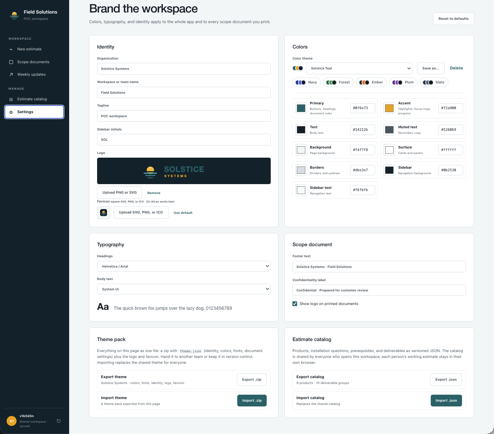

Settings applies to the whole app and to every scope document, for everyone.

- **Identity**: organization, workspace or team name, tagline, sidebar
  initials, a logo (PNG or SVG, shown in the document header), and a favicon
  (also used as the sidebar mark).
- **Colors**: five built-in, non-branded themes (Navy, Forest, Ember, Plum,
  Slate) as chips, plus nine individual colors. Edit any color and the
  drop-down reads "Custom (unsaved)"; **Save theme…** names it, and saved
  themes appear in the same drop-down and travel inside the theme pack.
- **Typography**: heading and body fonts.
- **Scope document**: footer text, confidentiality label, and whether to
  print the logo.
- **Theme pack**: export everything on this page as one `.zip` (a
  `theme.json` plus the logo and favicon files), or import one. This is how a
  design team hands over a brand, and how a theme is kept in version control.
  **Reset theme** returns everything on this page to the built-in defaults
  for everyone; it asks you to type `RESET` first and offers to export a
  backup. The catalog is not touched.
- **Estimate catalog**: export the shared catalog as `.json`, or import one to
  replace it. **Delete catalog** empties the shared catalog for everyone; it
  asks you to type `DELETE` first and offers to export a backup, which you can
  import again later.

Theme packs can also be built from a directory with
`npm run pack:theme -- packs/<name>`.

## Loading the Solstice example

`packs/solstice` is a complete fictitious vendor: nine products with a real
dependency graph, installation decisions with hours, prerequisites, deliverables, four
solutions, a teal-and-amber theme, and a sample estimate for a fictitious
customer.

1. `npm run pack:theme -- packs/solstice` produces `packs/solstice.zip`.
   In Settings, **Import .zip** under Theme pack.
2. In Settings, **Import .json** under Estimate catalog and choose
   `packs/solstice/catalog.json`.
3. On New estimate, **Import** and choose
   `packs/solstice/sample-estimate.json`, then open Scope documents.

`packs/solstice/sample-scope.pdf` is what the result looks like printed.

## Editors and viewers

When Scopewright runs behind an authenticating proxy (see
[openshift.md](openshift.md)), everyone the proxy admits can build estimates
and print scope documents. Only **editors** can change the shared catalog and
brand; everyone else sees those pages read-only with a "View only" notice.
Who is an editor is deployment configuration (`AUTH_EDITORS`), not something
set inside the app.
